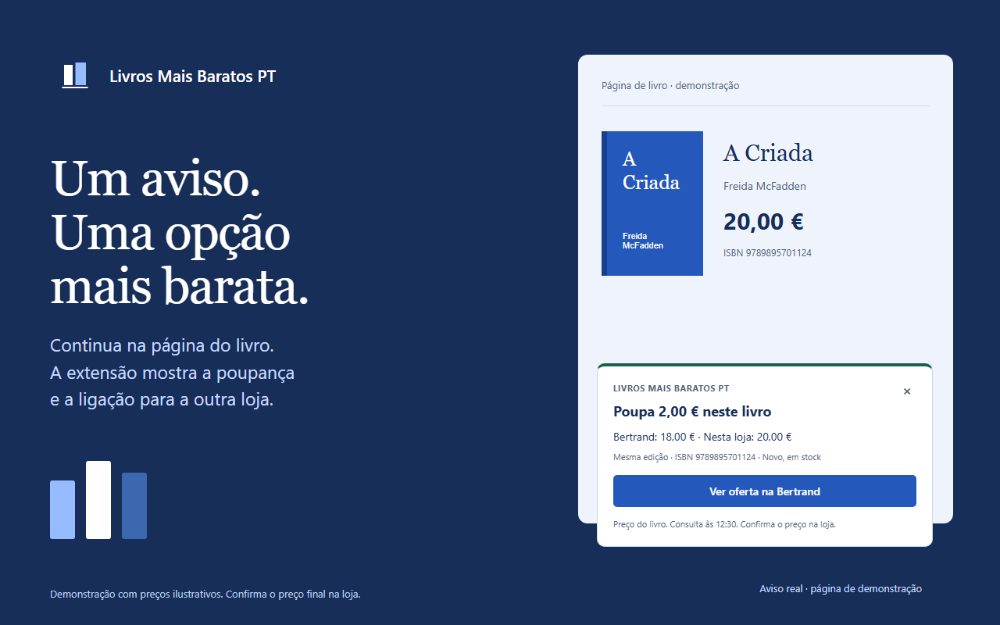
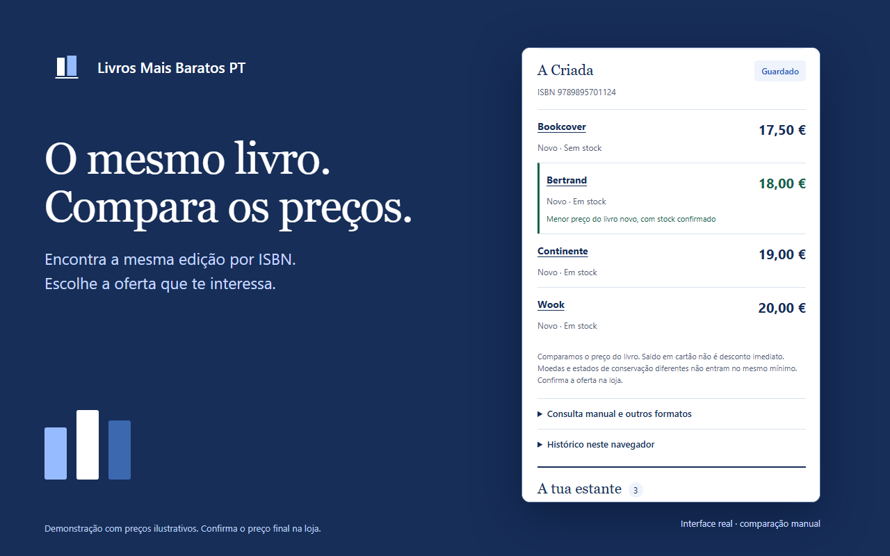
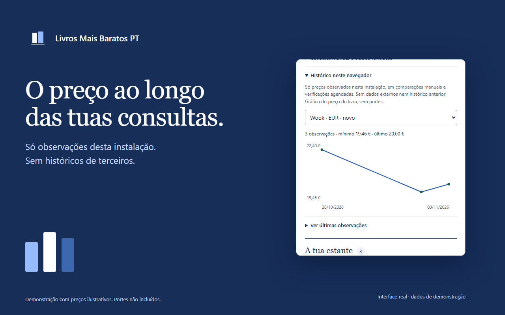

# Livros Mais Baratos PT

[](https://github.com/rfsbraz/livros-mais-baratos-pt/actions/workflows/ci.yml)
[](LICENSE)

Extensão para Chrome, Firefox e Edge que compara preços de livros em livrarias portuguesas. Encontra a mesma edição pelo ISBN, recebe avisos automáticos de ofertas mais baratas e acompanha os preços dos livros que queres comprar. A interface e a documentação estão em português de Portugal.



_Imagem de demonstração com preços ilustrativos, não ofertas em tempo real._

## Funcionalidades

- **Avisos automáticos** - Visita uma página de livro suportada. Se outra loja selecionada tiver a mesma edição nova em stock por menos, aparece um aviso. Depois de autorizares o acesso aos sites, não precisas de abrir o menu nem de configurar a função.
- **Seis lojas por predefinição** - Wook, Bertrand, Almedina, Continente, Porto Editora e Presença. Em **Definições**, podes escolher entre 26 adaptadores automáticos. As escolhas guardadas mantêm-se nas atualizações.
- **A mesma edição** - Valida ISBN-10 e ISBN-13. Separa livros usados, outras moedas e disponibilidade desconhecida das ofertas novas confirmadas em EUR.
- **Preços prontos ao abrir o menu** - Reutiliza resultados recentes de consultas em segundo plano, manuais e agendadas, indicando quando foram obtidos e se podem estar desatualizados.
- **Estimativas de portes** - Define custos de entrega, mínimos para portes grátis e campanhas com datas. Portugal continental é o destino predefinido. Portes desconhecidos nunca são considerados gratuitos.
- **Estante e preços-alvo** - Guarda até 100 livros, define um preço-alvo para o livro ou para o total com portes e recebe notificações de verificações aproximadamente diárias enquanto o navegador estiver aberto.
- **O teu próprio histórico** - Os gráficos usam apenas preços observados por esta instalação. Preferências, livros guardados, cache e histórico ficam no navegador e podem ser apagados.
- **Definições separadas** - Pesquisa, resultados e estante ficam no ecrã principal. Lojas, portes, avisos e afiliados ficam em **Definições**.

Consulta a [cobertura das lojas](docs/store-coverage.md) e as [regras de preços-alvo, portes e histórico](docs/targets-shipping-history.md).

## Instalação

### Lojas de extensões

A extensão ainda não está publicada na Chrome Web Store, no Firefox Add-ons ou no Edge Add-ons. As ligações serão adicionadas quando as páginas estiverem disponíveis. Entretanto, podes gerar os pacotes a partir do código.

### Instalação manual

#### Chrome e Edge

1. Obtém o pacote `-chrome.zip` ou `-edge.zip` correspondente, a partir da transferência disponibilizada ou do artefacto `extension-package` de uma [execução de CI concluída](https://github.com/rfsbraz/livros-mais-baratos-pt/actions/workflows/ci.yml).
2. Extrai o ZIP para uma pasta.
3. Abre `chrome://extensions` ou `edge://extensions`.
4. Ativa o **Modo de programador**, escolhe **Carregar expandida** e seleciona a pasta que contém `manifest.json`. Os nomes dos botões podem variar com o idioma do navegador.
5. Confirma as permissões de acesso às lojas. Os avisos ficam ativos por predefinição.

#### Firefox

Para testes locais, abre `about:debugging#/runtime/this-firefox`, escolhe **Carregar extra temporário** e seleciona `dist/firefox/manifest.json`. Esta instalação é temporária. Uma instalação permanente exige um pacote assinado pelo Firefox Add-ons, ainda não disponibilizado.

## Utilização

1. Visita a página de um livro numa loja selecionada. Quando o ISBN e o preço atual são verificáveis, a extensão compara em segundo plano e mostra um aviso se encontrar uma oferta elegível mais barata.
2. Abre o ícone da extensão para consultar os preços em cache ou comparar manualmente. Confirma ou introduz o ISBN e escolhe **Comparar**. Mantém o menu aberto durante a comparação manual.
3. Escolhe **Guardar** para adicionar um livro à estante. Define um preço-alvo, com ou sem portes, e consulta o histórico das tuas observações.
4. Abre **Definições** para escolher lojas, configurar **Entrega e portes**, alterar avisos ou afiliados e apagar dados. **Voltar aos preços** recupera os mesmos resultados.

### Preços, portes e disponibilidade

A comparação exige a mesma edição. O saldo em cartão não é um desconto imediato. Ofertas usadas, de vendedores externos ou noutras moedas mantêm essa identificação e não entram nos avisos automáticos de menor preço novo em EUR.

Os totais com portes são estimativas para um livro com entrega normal, sem taxas de importação ou serviços adicionais. Existem regras iniciais publicadas para Wook e Presença; nas restantes lojas, confirma ou introduz os portes. As regras expiram. A deteção automática de campanhas ainda não está implementada. Confirma sempre o preço final na loja.

Os adaptadores são experimentais. Em 3 de novembro de 2026, testes locais confirmaram ofertas em 18 dos 26 adaptadores; oito não concluíram os pedidos nesse ambiente. Uma amostra bem-sucedida não garante todo o catálogo. As falhas mantêm uma ligação para consulta manual e nunca recebem preços inventados. Consulta o [relatório de cobertura](docs/store-coverage.md).

## Permissões e privacidade

O acesso às lojas é pedido na instalação e continua sob controlo do navegador. Uma preferência guardada para desativar avisos é respeitada nas atualizações. Cada loja consultada recebe o ISBN e, quando necessário, o título, juntamente com dados normais de ligação, como o endereço IP. Os pedidos de comparação não enviam cookies de sessão. Não existe telemetria nem um serviço externo de histórico de preços.

`activeTab` permite a deteção manual; `scripting`, a deteção automática nos sites autorizados; `storage`, o armazenamento local; `alarms`, as verificações agendadas; e `notifications`, os avisos do sistema. Chrome e Edge usam `offscreen` para analisar páginas em segundo plano. Firefox usa uma página local de segundo plano e uma moldura de análise. A extensão não contorna captchas, não inicia sessão nas lojas e não executa código descarregado.

As ligações de afiliado Wook estão ativas por predefinição e podem ser desativadas em **Definições**. O código só é acrescentado num clique deliberado numa oferta Wook elegível e confirmada mais barata. Não influencia os pedidos, a comparação ou a ordenação. Consulta a [política de privacidade](PRIVACY.md).

## Desenvolvimento

### Requisitos

- Node.js 22.13 ou posterior na linha 22.x e npm.
- Git e um dos navegadores suportados.
- Acesso ao repositório enquanto este permanecer privado.

### Preparação

```sh
# Obter o código
git clone https://github.com/rfsbraz/livros-mais-baratos-pt.git
cd livros-mais-baratos-pt

# Instalar dependências e navegadores de teste
npm ci
npx playwright install chromium firefox msedge
```

Em Linux, acrescenta `--with-deps` ao comando de instalação dos navegadores para instalar as dependências do sistema.

### Comandos

```sh
# Verificar estilo, formatação e manifesto
npm run lint
npm run format:check
npm run check

# Aplicar correções de estilo e formatação
npm run lint:fix
npm run format

# Testar e gerar os três pacotes
npm run test:coverage
npm run build:all
npm run test:e2e
npm run audit:dependencies

# Gerar metadados, imagens e pacote de submissão
npm run store-listing:assets
npm run store-listing:check
```

`npm run build` e `npm run build:zip` geram o pacote Chrome. `npm run build:firefox` e `npm run build:edge` geram os restantes individualmente. Os resultados ficam em `dist/`. Depois de alterar código, volta a gerar e a carregar a extensão.

Os módulos da extensão ficam na raiz, os testes em `tests/unit` e `tests/e2e`, as ferramentas em `scripts` e os materiais de publicação em `store-listing`. Não há servidor nem dependências npm em execução na extensão. Consulta a [arquitetura](docs/architecture.md) e a [organização dos pacotes e publicação](docs/reference-alignment.md).

A CI verifica estilo, formatação, testes, pacotes, navegadores, dependências e segredos no histórico Git obtido. A [monitorização das lojas](docs/store-monitoring.md) distribui as 26 lojas por 24 períodos horários com atrasos aleatórios e acompanha falhas em issues.

## Páginas nas lojas de extensões

O [pacote de submissão](store-listing/README.md) inclui metadados em português de Portugal, cinco capturas de ecrã, ícones, imagens promocionais, informações de privacidade e instruções de revisão. A [automação e configuração](store-listing/AUTOMATION.md) segue a extensão Geocaching: publicação por versões etiquetadas, sincronização de texto e imagens no Firefox, notas baseadas no registo de alterações e verificações semanais de credenciais e divergências.

| Comparar preços com portes                                                                       | Acompanhar as tuas observações                                                                            |
| ------------------------------------------------------------------------------------------------ | --------------------------------------------------------------------------------------------------------- |
|  |  |

`npm run store-listing:assets` regenera as imagens e o ZIP de submissão. As versões publicadas no GitHub anexam esse pacote aos ZIPs dos navegadores. Chrome e Edge continuam a exigir a introdução de texto e imagens nos respetivos painéis; Firefox permite sincronizá-los pela API. A publicação permanece desativada até serem configuradas as contas e credenciais desta extensão.

## Contribuir

São bem-vindos relatos de erros, melhorias de acessibilidade, documentação e adaptadores bem testados. Consulta o [guia de contribuição](CONTRIBUTING.md). Documentação, issues e PRs devem usar português de Portugal; as mensagens de commit podem continuar em inglês. O código usa a licença MIT; nomes de lojas e conteúdos de terceiros continuam a pertencer aos seus titulares.

## Segurança

Consulta a [política de segurança](SECURITY.md) para comunicar vulnerabilidades de forma privada.

## Licença

Projeto distribuído sob a [licença MIT](LICENSE). O texto jurídico original é mantido em inglês; existe uma [tradução informativa](LICENSE.pt-PT.md).

## Agradecimentos

- [Geocaching Friends Logs](https://github.com/rfsbraz/Geocaching.com-Friends-Logs), pela estrutura de referência.
- [Playwright](https://playwright.dev/) e [playwright-webextext](https://github.com/ueokande/playwright-webextext), pelas ferramentas de teste.

## ☕ Apoiar

Se esta extensão te for útil e quiseres apoiar o desenvolvimento, podes [oferecer-me um café](https://buymeacoffee.com/rfsbraz). Sem qualquer obrigação, apenas uma forma simpática de agradecer.
