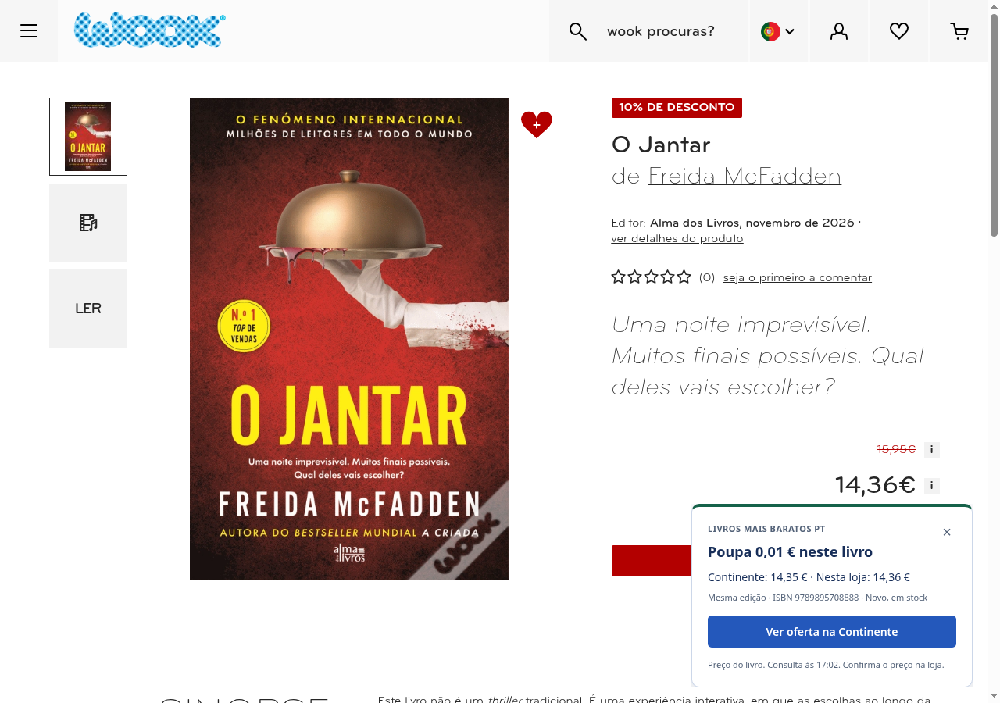

# Prova #79 — aviso em página na Wook (Chrome, sem clique no menu)

- URL **live**: `https://www.wook.pt/livro/o-jantar-freida-mcfadden/33978897`
- Extensão: `dist/chrome` deste PR, instalação fresca (perfil Playwright temporário).
- Método: Chromium **headed** (`headless: false`) em `DISPLAY=:1`, canal `chromium`, **sem** `page.route` / `route.fulfill` e **sem** HTML estático — `page.goto` directo à URL live da Wook.
- Sem abrir o popup: o content script `book-alerts` corre e mostra `#lmb-price-alert` sobre a página com CSS carregado (cabeçalho Wook, capa do livro, tipografia).
- Cookies do site foram aceites na captura para não taparem o layout; o aviso da extensão fica no canto inferior direito.
- Tentativa de captura «antes» com o build `v0.1.7`: num perfil fresco com host permissions concedidas, o `book-alerts` também registou e o banner apareceu. O defeito corrigido neste PR é o fingerprint sticky com `stores.length === 0` (grants ainda vazios), coberto pelos testes unitários em `book-alerts-sync.test.js`, não uma falha permanente do 0.1.7 quando o sync tem origens.

